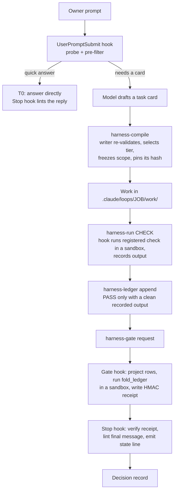

# dynamic-harness

**A per-task harness for Claude Code.** It sizes each request, freezes the work list, runs registered checks in
a sandbox, and lets a task end as "done" only when a gate has signed what was actually checked.

dynamic-harness is a Claude Code plugin built on
[loop-contract](https://github.com/hdkhosravian/loop-contract-skill). Hooks do the enforcement, and the model
never writes its own record of progress. A quick question still gets a quick answer. A figure that someone will
act on goes through a frozen scope, a recorded check and an HMAC-signed receipt.

> **Status (0.4.0):** build phases P1 to P5 are complete: the v1 scope of the design spec, in English and
> Persian. One check is still open: a full end-to-end `claude -p` run from a request to a signed "Checked" in a
> set-up folder. See [Status and roadmap](#status-and-roadmap).

---

## Contents

- [Why](#why)
- [What it guarantees](#what-it-guarantees)
- [How a request flows](#how-a-request-flows)
- [Trust model](#trust-model)
- [Tiers](#tiers)
- [What the owner sees](#what-the-owner-sees)
- [Hooks](#hooks)
- [Command-line tools](#command-line-tools)
- [Requirements](#requirements)
- [Install](#install)
- [Set up a folder](#set-up-a-folder)
- [Data layout](#data-layout)
- [Testing](#testing)
- [Status and roadmap](#status-and-roadmap)
- [Repository layout](#repository-layout)
- [Documentation](#documentation)
- [Limits](#limits)
- [License](#license)

---

## Why

A coding agent with a long task tends to fail in a few predictable ways:

- It says "done" when part of the work is missing, or when nothing was checked.
- It adds up numbers in its head, and the total is wrong or in the wrong unit (for example Toman versus Rial,
  which differ by ten times).
- Its work list shrinks quietly: three of twenty items get done, and the report covers those three.
- It checks its own work and words the result as "verified".
- It takes an action that cannot be undone (sending, paying, publishing) without approval.
- It asks the owner too many questions, or none when one was needed.

Prompting does not fix these reliably, because the same model that makes the mistake also writes the report.
dynamic-harness moves the decisions that matter out of the model and into deterministic code that runs in
Claude Code hooks.

## What it guarantees

The design spec states these as numbered requirements. The ones built so far:

| ID | Guarantee |
| --- | --- |
| R-1 | A quick (T0) answer is never slowed down or altered by the harness, apart from the always-on safety hooks. |
| R-2 | A task is "done" only if the gate wrote a receipt whose hash matches the current ledger, scope and submitted files. |
| R-3 | The frozen work list never shrinks silently. Every unit ends in a named state, and a removal must cite the owner's own words. |
| R-4 | No irreversible action runs without approval. In v1 every irreversible class is denied; research GETs run only under a grant the owner approved. |
| R-5 | The agent loads only approved procedures (skills whose content hash is recorded with an approver). |
| R-6 | Writes to the harness's own records are prevented for tools, and detected for everything else. Detection fails the gate and the Stop hook. |
| R-7, R-8 | Contacts are capped: at most 5 blocking questions per task, at most 3 start questions, and no new questions after 50% progress. |
| R-9 | User memory is written only by a hook, from structured answers, using a closed schema. |
| R-10 | Every deliverable carries exactly one of three plain-language states (see [What the owner sees](#what-the-owner-sees)). |
| R-11 | A figure someone will rely on is never a quick answer, and every aggregate is computed by a script. |
| R-12 | Every money figure states its metric and definition version, the period in the owner's calendar and Gregorian, the source and its data-up-to date, the unit and currency, and the exclusions. |
| R-13 | Every claim in a research report traces to a claim row: a page the harness fetched itself, a verbatim quote, a date and a source class; load-bearing claims need two independent sources. |
| R-14 | Every number in a forecast traces to a model cell; results are ranges with drivers and a flip point; the report says "Arithmetic checked; assumptions not." |
| R-15 | Every finished or stopped task writes a decision record outside the workspace, with personal data redacted. |

## How a request flows



1. **Probe.** The prompt hook records the turn and runs a deterministic probe: action verbs, money and
   quantity tokens, files named, data classes, irreversible classes. It decides between a quick answer and a
   task card, and sets a minimum tier.
2. **Card.** For anything bigger, the model drafts a task card: deliverable, units of work, oracle, reliance,
   cost of error, decision class.
3. **Compile.** `harness-compile` only prints a request. The PostToolUse writer re-validates the card, raises
   any field the probe found, selects the tier with code, freezes the scope (`scope.v1.jsonl`, pinned by
   hash), sets the budget and writes the opening line the model must print.
4. **Work.** The model works in the task's `work/` folder. Every call is charged to the budget. A pending
   card, a stop or a pause allows only reads.
5. **Checks.** Registered pack checks run inside the hook, in an OS sandbox, never in the model's shell. Their
   outputs are recorded with a hash.
6. **Ledger.** A unit can be marked PASS only by citing a clean output of its own registered check, from the
   same attempt. A second failure becomes "done, not fully checked" or "blocked", never a silent pass.
7. **Gate.** `harness-gate request` triggers the gate hook. It copies the deliverables, projects the ledger
   into loop-contract's format, runs `fold_ledger.py` in a sandbox, checks that nothing changed while it ran,
   and writes a receipt signed with a key the agent cannot read.
8. **Stop.** The Stop hook never runs the gate. It verifies the receipt, lints the final message for
   self-certifying words and for numbers the gate did not trace, then shows the state line.

## Trust model

- **Hooks are the only trusted writers.** Every `harness-*` CLI the agent calls only prints a JSON request.
  A PostToolUse writer validates it and applies it, or refuses with a reason.
- **Hash-chained event log.** Each task has an append-only `events.jsonl`. Every event carries the previous
  event's hash and, for a protected file, that file's hash. An edit outside the harness breaks the chain or a
  file hash, and the task stops as `STOPPED_TAMPER`.
- **Protected paths.** The harness's data folder, keys, settings and every `CLAUDE.md` are write-protected.
  Setup adds matching Claude Code sandbox and permission rules.
- **Sandboxed code.** The gate, pack checks and agent-written scripts run under `sandbox-exec` (macOS) or
  `bubblewrap` (Linux): no network, writes only in their own folder, and the harness's data unreadable.
- **Signed receipts.** The gate receipt is an HMAC over the event head, scope hash, submitted tree, report,
  gate files, control, business and core hashes, mode and caps. The key lives in a folder the agent cannot
  read.
- **Fail closed.** Every hook has `onFailure: "block"` and a watchdog. A crash, a timeout or a malformed result
  is a denial, never a pass.
- **Lease.** One session owns a task at a time, with a heartbeat and epoch fencing, so two sessions cannot
  write the same ledger.

## Tiers

| Tier | When | What happens |
| --- | --- | --- |
| **T0** | General knowledge, wording, a quick lookup; low risk, no computed numbers, no reliance | Answer directly. Only the safety hooks and the Stop lint apply. |
| **T1** | Single-session work with an executable check and at most 5 units | Card, frozen scope, budget (150 calls or 30 minutes), recorded checks, gate. |
| **T2** | Irreversible actions, high risk, sign-off classes, more than 5 units, or several sessions | As T1, with a larger budget (60 calls per unit) and stricter routing. |
| **Refused** | Decision classes with a `refuse` policy (medical, safety by default) | The card and a decision record are written; no work runs. |

The selector is code (`tier_select.py`), and a test applies every row of the spec's task taxonomy to it.

## What the owner sees

Every deliverable ends with one of three states, rendered from the receipt:

- **Checked**: every unit passed its registered check, in the gate's done mode.
- **Done, not fully checked: \<what\>**: something was not checked, and the state names it (a failed check,
  a number the gate could not trace, a unit with no executable check).
- **Partly done: N of M**: some units are blocked or not done. Budget, stall and cost stops reach the owner
  this way, with the cost of continuing.

Words such as "checked", "verified", "confirmed" and "matches" may appear only in that state line. The gate and
the Stop hook both enforce this.

## Hooks

| Event | Timeout | What it does |
| --- | --- | --- |
| SessionStart | 5 s | Compares control, business, plugin and loop-contract hashes with the setup baseline; checks approved skills, the Claude Code and loop-contract versions, the sandbox and the setup; runs a PreToolUse canary. |
| UserPromptSubmit | 10 s | Records the turn; handles `/dynamic-harness:setup` without the model; routes replies, corrections and follow-ups; runs the probe and pre-filter. |
| PreToolUse | 5 s | Pending-card gate, subagent lanes, contact caps, then safety: irreversible classes, egress allowlist and research grants, query guard, protected paths. |
| PostToolUse | 5 s | Records written files, applies writer requests, charges the budget, runs the tripwire. |
| PostToolUse (`--gate`) | 1800 s | Runs the gate on a lone `harness-gate request`. |
| SubagentStop | 5 s | Records harness subagents; accepts only schema-valid claim rows from the researcher. |
| Stop | 10 s | Verifies the receipt, lints the final message and decides whether the turn may end. |
| ConfigChange | 5 s | Watches settings changes against the session baseline. |

## Command-line tools

All of them live in `bin/` and only print a request; the hook that owns each one does the work.

| Tool | Purpose |
| --- | --- |
| `harness-probe` | Show the probe result for a request. |
| `harness-card validate\|merge` | Validate a card draft; merge two drafts. |
| `harness-compile --card FILE [--reunderstand TURN]` | Compile a card into a task, or re-understand the open task after a correction. |
| `harness-ledger append --kind unit\|verdict\|decision\|contradiction\|milestone` | Append a ledger row under the ledger's rules. |
| `harness-run CHECK --unit U --attempt N [--input FILE] [--arg K=V]` | Run a registered pack check in the hook's sandbox and record its output. |
| `harness-answer header --unit U --output SHA` | Render the answer header from a recorded check and the business layer. |
| `harness-claims fetch URL`, `harness-claims cite --unit U --claims N,M` | Fetch a page for the researcher; say which claim rows decide a unit. |
| `harness-model assume\|register\|scenario\|import` | Record assumptions, register a model after its gate, run a scenario, import a returned sheet. |
| `harness-normalize`, `harness-lint-user-text` | Show how the harness reads a value; lint the harness's own user-facing text. |
| `harness-contact TYPE [--handoff\|--accept latest]` | Ask the owner something within the contact rules; accept a plan or a cost increment. |
| `harness-research render`, `harness-critic render` | Render the only prompts the researcher and verifier subagents may receive. |
| `harness-gate request` | Ask the gate hook to run the gate. |
| `harness-sandbox-exec FILE` | Run a script the agent wrote, with no network and no access to secrets. |

Subagents (`agents/`): `web-researcher` (web only, returns claim rows), `data-analyst` (owner files, no web),
`verifier` (read only, prompt rendered by the harness) and `card-drafter-2` (a second card draft, logged in
shadow mode).

## Packs

| Pack | Checks | For |
| --- | --- | --- |
| `finance` | `finance.reconcile`, `finance.kpi`, `finance.bridge`, `finance.list` | Questions on the owner's own data: two computation paths, control totals, coverage, own-account transfers, a ×10 magnitude check, data that ends early |
| `research` | `research.check`, `research.report` | Investigations: fetched snapshots, verbatim quotes, freshness, two independent origins, a recorded verifier verdict, confidence |
| `model` | `model.recalc`, `model.checks`, `model.report` | Forecasts: every cell, ranges, runway, flip point, top drivers; identities, tags, metamorphic tests, back-cast, backtest against a naive baseline |
| `operations` | `doc.check`, `decide.score_flip` | Documents (required items, placeholders, footer, do-not-contact) and decisions (weighted scores, constraints, flip test) |

In done mode the gate's oracle replays every check a passing unit cites, on the deliverables as submitted.

## Owner commands

All of them run in a hook; Claude never sees them. Anything that changes something shows the change in plain
words with a one-time code first.

| Command | What it does |
| --- | --- |
| `/dynamic-harness:business` | Currency, calendar, fiscal year, spending limits, own accounts, protected names, language |
| `/dynamic-harness:memory` | What the harness remembers about how you like your work; set or forget it |
| `/dynamic-harness:status` | Your tasks; abandon one, or close one that was stopped for tampering |
| `/dynamic-harness:export` | Decision records as CSV, by task or by month |
| `/dynamic-harness:config`, `/dynamic-harness:off` | Operator settings; put the contact cap and the tripwire in shadow mode |

## Requirements

- Claude Code 2.1.295 or later (hooks must be able to fail closed).
- `/usr/bin/python3` 3.9 or later, and `/usr/bin/git`. Everything else is the Python standard library.
- The [loop-contract](https://github.com/hdkhosravian/loop-contract-skill) plugin, version 1.1.0 or later.
- macOS, or Linux with `bubblewrap` (`apt install bubblewrap`) and unprivileged user namespaces allowed.

## Install

In Claude Code:

```text
/plugin marketplace add hdkhosravian/loop-contract-skill
/plugin install loop-contract@loop-contract
/plugin marketplace add hdkhosravian/dynamic-harness
/plugin install dynamic-harness@dynamic-harness
```

Then set up each folder you want to use it in.

## Set up a folder

1. Open Claude Code in the project folder and accept the folder trust prompt, so that the hooks run.
2. Type `/dynamic-harness:setup`. The hook shows every change it would make, grouped by file, plus a one-time
   code. Nothing changes yet, and Claude never sees this exchange.
3. To apply, type `/dynamic-harness:setup confirm <code>`. The code works once, in this session, for 10
   minutes.
4. Start a new Claude Code session in the folder. The sandbox and the session checks apply from then on.

Use `/dynamic-harness:setup status` to check the folder. `/dynamic-harness:setup undo` reverses setup's own
changes. It does not touch a value you changed after setup, and it keeps every other edit; the undo plan lists
both.

Until a folder is set up, only quick (T0) answers run there.

### What setup changes

- `~/.claude/settings.json`: the key `sandbox.network.strictAllowlist`. It acts only in projects that turn the
  sandbox on. In those projects, commands reach only the domains that project allows, with no prompt to add
  one. Some lists apply to every project, including this one: allowed network domains, sandbox-exempt
  commands, socket allowances and custom proxy ports. If your user settings set any of these, setup also
  removes them there, and other projects lose them too. The plan says so before you confirm.
- This folder's `.claude/settings.local.json`:
  - the sandbox is on, and commands do not run if it cannot start;
  - no command may run outside the sandbox, and commands get no network access;
  - commands cannot read the harness's private data, or change Claude's settings, the plugins or any
    `CLAUDE.md`;
  - permission-bypass mode is off.
- The harness's data folder: a 32-byte signing key (`keys/hmac.key`, mode 0600) and a baseline of the release
  hashes in `config_log.jsonl`.

Other projects keep their own settings.

## Data layout

```text
${CLAUDE_PLUGIN_DATA}/            # read- and write-denied to the agent
  keys/hmac.key                   # receipt signing key
  config_log.jsonl                # release and layer hashes from setup
  control/                        # control layer (defaults in control/defaults/)
  business/                       # business layer (profile, metric dictionary, sources)
  runs/<job>/                     # card versions, tier, scope versions, ledger, outputs, events.jsonl,
                                  # gate/ projection, receipt.json
  heads/<job>                     # event-log head
  records/<job>.jsonl             # decision records (R-15)
  sessions/<sid>/                 # session state, settings baseline, written-files record

<workspace>/.claude/loops/
  drafts/card.json                # the model's card draft
  <job>/work/                     # deliverables (submitted to the gate as a copy)
  <job>/requests/                 # scratch files for CLI requests
```

## Testing

```bash
python3 -m pytest -q
```

- About 1,670 tests, standard library plus pytest. On macOS the full suite passes (1671 passed, 7 skipped,
  3 xfailed at release 0.4.0).
- The gate integration tests use a real `fold_ledger.py` from a `loop-contract-skill` checkout next to this
  repository, or from `HARNESS_FOLD_LEDGER`. `HARNESS_REQUIRE_INTEGRATION=1` turns a missing fold_ledger into a
  failure instead of a skip.
- Linux: the suite passes on Ubuntu 22.04 and 24.04 in `--privileged` containers (bubblewrap needs user
  namespaces).
- `tests/corpus/bypass.jsonl` holds 200+ attempts to get around the safety hook (shell wrappers, symlinks,
  `mv`, MCP, `osascript`, scripts the agent wrote, forged receipts) with the expected decision for each.
- `spike/` holds the platform spike that settled how Claude Code hooks behave (OQ-4), and the P5 setup spike.

## Status and roadmap

| Phase | Scope | State |
| --- | --- | --- |
| P1 | Canonical hashing, event log, ledger, scope versions, gate adapter, receipts; loop-contract 1.1.0 gate flags | Done |
| P2 | Safety hook, irreversible classes, egress, query guard, protected paths, sandbox launcher, session and config checks, turns, bypass corpus | Done |
| P3 | Probe, card, compiler, tier selector, contacts, user memory, tripwire, lanes, SubagentStop, PII redaction, corrections, shadow second draft | Done |
| P4 | Lease, budget, stall and cost stops, gate hook, Stop hook, RE_UNDERSTAND, follow-ups, decision record | Done |
| P5 | `/dynamic-harness:setup` | Done |
| P5 | Domain packs and `harness-run`; gate done mode with a replaying oracle | Done |
| P5 | Business layer (`/dynamic-harness:business`, metric dictionary, money caps, estimates), answer header (R-12) | Done |
| P5 | Claim fetching and the research pack (R-13); the model-checks pack and `harness-model` (R-14) | Done |
| P5 | Operations pack (`doc.check`, `decide.score_flip`) | Done |
| P5 | Persian templates, `harness-lint-user-text`, `/dynamic-harness:memory`, `status`, `export`, `config`, `off` | Done |
| P5 | Business trap suite and R-11 to R-15 tests | Done |
| P5 | End-to-end `claude -p` run to a signed receipt in a set-up folder | Open |
| v2 | Write connectors, the two-lane outbox, approval matrix, automations, learning editor | Planned |

Persian and Jalali support is part of the design: Persian and Arabic digits, ی/ي and ک/ك, ZWNJ, Jalali dates
including leap Esfand, the fiscal year, and Toman and Rial with a ×10 magnitude check.

## Repository layout

```text
.claude-plugin/     plugin.json, marketplace.json
agents/             plugin subagents (tool-restricted; hooks enforce the rest)
bin/                harness-* CLIs (request printers) and harness-hook (the hook entry point)
commands/           slash commands (setup, business, memory, status, export, config, off)
control/defaults/   default control layer: classes, egress allowlist, protected paths, gate profiles, tiers, ...
hooks/hooks.json    hook registration (every entry fails closed)
lib/harness_core/   the library: one module per concern
schema/             JSON Schemas for run records and the card
skills/             executor guidance (task-card) and the domain packs (finance, research, model, operations)
tools/              release tooling (pack hashes, skill approvals)
templates/          user-facing text in English and Persian
tests/              pytest suite, bypass corpus, card fixtures
spike/              Claude Code platform spike
```

## Documentation

- [`dynamic_harness_design_spec.md`](dynamic_harness_design_spec.md): the normative design. Its "Build
  decisions" sections record how each phase was built and why it differs from the draft where it does.
- [`INTERFACES.md`](INTERFACES.md): the interface contract between modules, phase by phase.
- [`spike/RESULTS.md`](spike/RESULTS.md): the platform facts the design relies on.

## Limits

- The harness checks arithmetic, coverage, citations and process. It does not check whether an assumption or a
  judgement is right, and the report says so.
- v1 connectors are read-only. Sending, paying and publishing are denied, not queued for approval.
- Claude Code's own sandbox on Linux has not been verified live; the harness's sandbox has.
- Professional sign-off classes (tax, legal, employment) stay "prepared, not final".
- Check notes (rows left out, sources that disagree) are written in English, also inside Persian text.
- A forecast is a JSON driver model plus a CSV table, not a formula workbook; Monte Carlo runs are not built.

## License

[MIT](LICENSE). Anyone may use, copy, change, merge, publish, distribute, sublicense and sell it, for any
purpose, anywhere, as long as the copyright and license notice stay with the copies.
