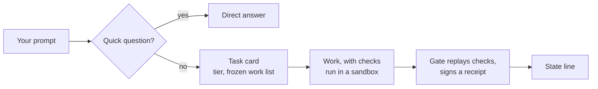

# dynamic-harness

[](LICENSE)
[](CHANGELOG.md)
[](docs/getting-started.md)
[](docs/development.md)
[](https://docs.claude.com/en/docs/claude-code)

**Checked work from Claude Code, enforced by code.** dynamic-harness is a Claude Code plugin that decides how
much checking each request needs, and then enforces it with hooks. A quick question gets a quick answer; a
figure you will act on is computed by a registered check in a sandbox, and the task ends as "done" only when a
signed receipt says what was checked.

## Who it is for

- **Business owners** who use Claude Code on their own data: sales and bank exports, invoices, forecasts,
  research, documents. You get figures that are computed, not guessed, and a plain statement of what was
  checked.
- **Operators** who set up Claude Code for someone else, and want "done" decided by code, not by the model.
- **Developers** who want a worked example of enforcing an agent contract with Claude Code hooks.

## Why

A coding agent on a long task fails in a few predictable ways. It says "done" when part of the work is
missing. It adds numbers in its head and gets the total or the unit wrong (Toman and Rial differ by ten
times). Its work list shrinks quietly. It checks its own work and calls it "verified". It takes an action that
cannot be undone. Prompting does not fix these reliably, because the same model that makes the mistake also
writes the report. dynamic-harness moves those decisions into deterministic code that runs in hooks.

## Quick start

You need Claude Code 2.1.295 or later, `/usr/bin/python3` 3.9 or later, and macOS or Linux with bubblewrap.
See [Requirements](#requirements).

1. Install the plugins. In Claude Code, type:

   ```text
   /plugin marketplace add hdkhosravian/loop-contract-skill
   /plugin install loop-contract@loop-contract
   /plugin marketplace add hdkhosravian/dynamic-harness
   /plugin install dynamic-harness@dynamic-harness
   ```

2. Open Claude Code in your project folder, accept the folder trust prompt, and type:

   ```text
   /dynamic-harness:setup
   ```

   The harness shows every change it would make and a one-time code. Nothing changes yet.

3. Apply the plan:

   ```text
   /dynamic-harness:setup confirm <code>
   ```

4. Start a new Claude Code session in the folder.

5. Ask something that needs your data, for example:

   ```text
   What were our total sales in March, from sales.csv?
   ```

   Claude drafts a task card, runs a registered check, and ends with a state line such as **Checked**.

The [getting started guide](docs/getting-started.md) explains each step, what setup changes, and how to undo
it.

## How it works



- **Hooks decide, the model works.** Every `harness-*` command the model runs only prints a request. A hook
  checks it and writes the record, or refuses it.
- **Code picks the tier.** T0 is a direct answer. T1 and T2 get a frozen work list, a budget, recorded checks
  and a gate. Medical and safety decisions are refused.
- **Checks compute every figure.** Registered pack checks run in an OS sandbox. A unit passes only by citing
  a clean recorded output of its own check.
- **The gate signs.** loop-contract's `fold_ledger.py` runs in a sandbox, every cited check is replayed on the
  delivered files, and the receipt is signed with a key the model cannot read.
- **Stop verifies.** The Stop hook checks the receipt and the final message, then shows the state line.
- **Fail closed.** A crash, a timeout or a bad result is a denial, never a pass.

Read more: [how it works](docs/how-it-works.md) (diagrams of the components, one task, the lifecycle and the
tier choice) and [security](docs/security.md) (what the model can and cannot write).

## What you get

Every deliverable ends with exactly one of three states:

| State | Meaning |
| --- | --- |
| **Checked** | Every part passed its registered check, replayed by the gate. |
| **Done, not fully checked: \<what\>** | Something was not checked, and the line names it. |
| **Partly done: N of M** | Some parts are blocked or not done, for example after a budget stop. |

Words such as "checked", "verified" and "confirmed" may appear only in that line. A money figure also carries
a three-line header: the metric and its definition version, the period in your calendar and in Gregorian, the
source and how recent its data is, the unit, the exclusions and the check status.

## Packs

| Pack | Checks | For |
| --- | --- | --- |
| `finance` | `finance.reconcile`, `.kpi`, `.bridge`, `.list` | Figures from your own data, with a second computation path, control totals, coverage and a ×10 check |
| `research` | `research.check`, `.report` | Investigations: fetched pages, verbatim quotes, freshness, two independent sources |
| `model` | `model.recalc`, `.checks`, `.report`, `.workbook` | Forecasts: ranges, runway, flip point, drivers, backtest, Monte Carlo, a formula workbook |
| `operations` | `doc.check`, `decide.score_flip` | Documents and decisions: required items, placeholders, weighted scores, flip test |

Details and examples: [packs](docs/packs.md).

## Your commands

These run in a hook; Claude never sees them. Every change shows a plain-language plan and a one-time code
first.

| Command | What it does |
| --- | --- |
| `/dynamic-harness:setup` | Set up, check (`status`) or undo the folder setup |
| `/dynamic-harness:business` | Currency, calendar, fiscal year, spending limits, own accounts, protected names, language |
| `/dynamic-harness:memory` | How you like your work: tone, format, report style, rounding |
| `/dynamic-harness:status` | Your tasks; abandon one, or close one stopped for tampering |
| `/dynamic-harness:export` | Decision records as CSV, by task or by month |
| `/dynamic-harness:config`, `/dynamic-harness:off` | Operator settings; put the question cap and the tripwire in shadow mode |

See the [owner guide](docs/owner-guide.md).

## Persian support

Persian is a first-class language, not a translation. The harness's own messages are written natively in
Persian (`templates/fa.json`), with Persian digits. Dates use the Jalali calendar, including leap Esfand and
your fiscal year, next to the Gregorian dates. Amounts handle Toman and Rial (1 Toman = 10 Rial), with a check
for a ×10 mix-up. Names match across Arabic and Persian letter forms and ZWNJ. Check notes appear in your language.

## What is new

Release 0.4.0 completes the v1 scope: domain packs, a gate that replays every check, the business layer, answer
headers, research with fetched sources, forecasts with a formula workbook and Monte Carlo, Persian, and the
owner commands. See the [changelog](CHANGELOG.md).

## Requirements

- Claude Code 2.1.295 or later (hooks must be able to fail closed).
- `/usr/bin/python3` 3.9 or later, and `/usr/bin/git`. Everything else is the Python standard library.
- The [loop-contract](https://github.com/hdkhosravian/loop-contract-skill) plugin, version 1.1.0 or later.
- macOS (`sandbox-exec`), or Linux with bubblewrap (`apt install bubblewrap`) and unprivileged user namespaces
  allowed.

## Documentation

| Page | For |
| --- | --- |
| [Getting started](docs/getting-started.md) | Install, set up a folder, run a first task, fix common problems |
| [Owner guide](docs/owner-guide.md) | What you see, the three states, questions, stops, your commands, Persian |
| [How it works](docs/how-it-works.md) | Components, one task step by step, lifecycle, tiers, hooks, CLIs, data layout |
| [Packs](docs/packs.md) | Every check, the answer header, research, forecasts, workbook, Monte Carlo |
| [Security](docs/security.md) | Trust boundary, mechanisms, guarantees R-1 to R-15, known gaps |
| [Development](docs/development.md) | Tests, repository layout, adding a pack |
| [FAQ](docs/faq.md) | Short answers |
| [Design spec](dynamic_harness_design_spec.md) | The normative design; "Build decisions" record what was built |
| [Interfaces](INTERFACES.md) | The contract between modules |
| [Changelog](CHANGELOG.md) | What changed in each release |

## Status and roadmap

- **Release 0.4.0** covers the full v1 scope of the [design](dynamic_harness_design_spec.md). The test suite (about
  1,680 tests) passes on macOS and on Ubuntu 22.04 and 24.04; see [development](docs/development.md).
- **Being verified:** a live, end-to-end `claude -p` run from a request to a signed "Checked" in a set-up folder.
- **Next (v2):** write connectors with an approval outbox, an approval matrix, scheduled automations and a
  learning editor.

Issues and pull requests are welcome.

## Limits

- The harness checks arithmetic, coverage, citations and process. It does not check whether an assumption or a
  judgement is right, and the report says so.
- v1 connectors are read-only. Sending, paying and publishing are denied, not queued for approval.
- Claude Code's own sandbox on Linux has not been verified live; the harness's own sandbox has.
- Professional sign-off classes (tax, legal, employment) stay "prepared, not final".
- A research run has no separate count of tokens read: it shares the task's call budget and stall rule.

## License

[MIT](LICENSE). Anyone may use, copy, change, merge, publish, distribute, sublicense and sell it, for any
purpose, anywhere, as long as the copyright and license notice stay with the copies.
