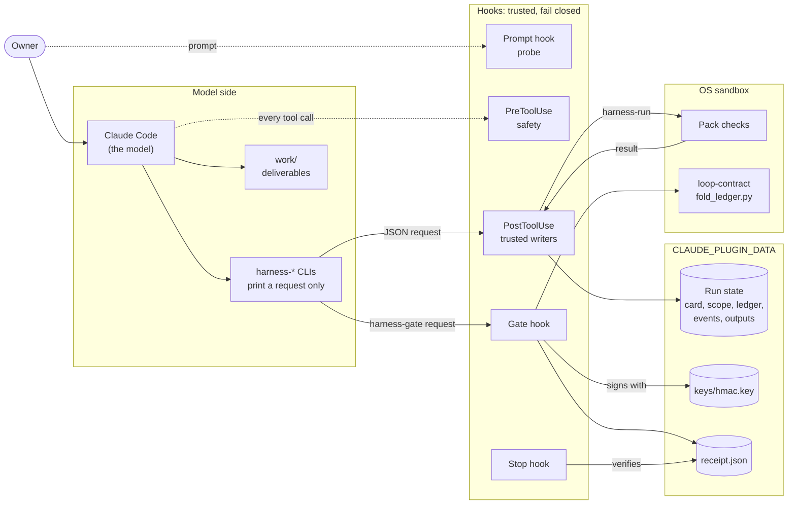
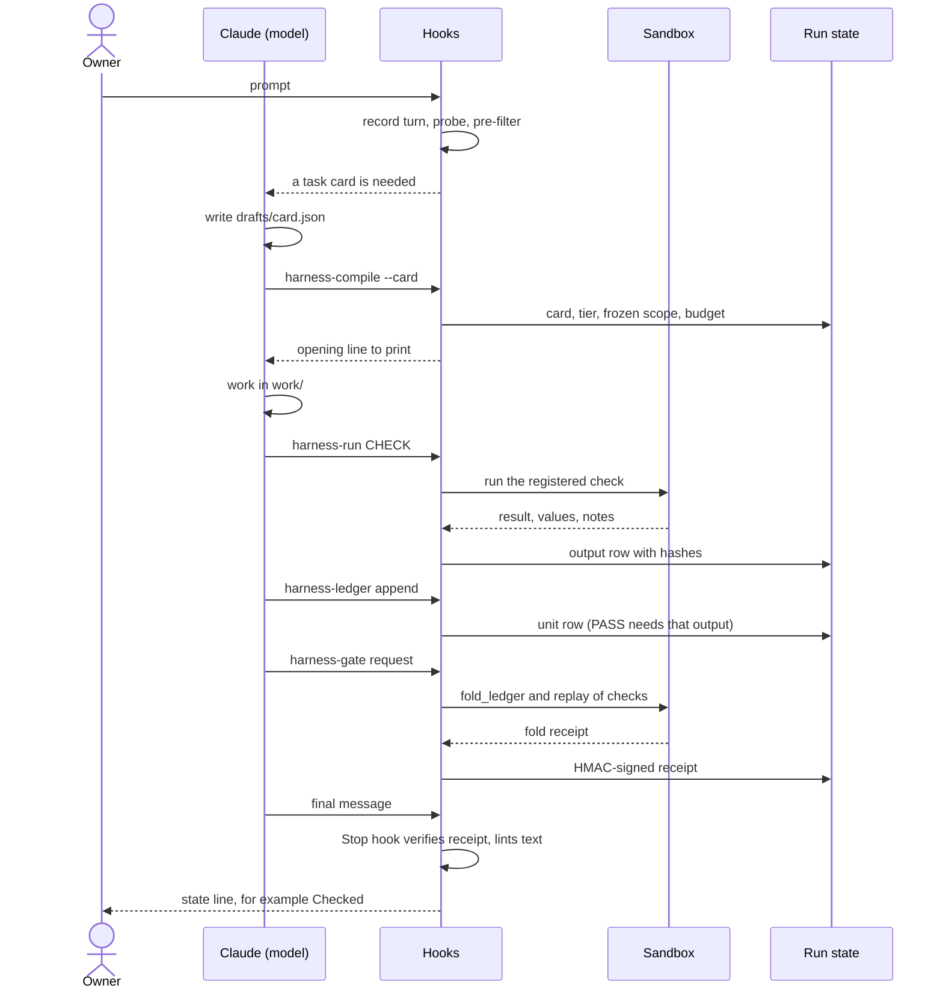
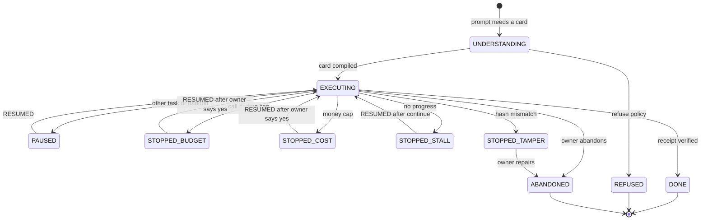
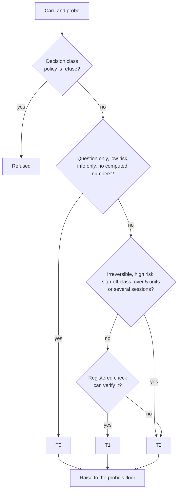

# How it works

This page explains the moving parts: what runs where, how one checked task flows, how a task moves between
states, and how the tier is chosen. For the trust rules behind it, see [security.md](security.md).

## The one idea

The model does the work. It never writes its own record of progress, and it never decides that the work is
done. Claude Code hooks do that, with plain Python code that the model cannot change.

Every `harness-*` command the model runs only **prints a JSON request**. A hook reads the request, checks it
and applies it, or refuses it with a reason.

## Components



| Part | Where | What it does |
| --- | --- | --- |
| Claude Code | your session | Drafts the task card, does the work in `work/`, runs the `harness-*` CLIs. |
| `harness-*` CLIs | `bin/` | Print a JSON request. They write nothing. |
| Hooks | `hooks/hooks.json`, `lib/harness_core/` | Probe each prompt, guard each tool call, apply requests, run checks and the gate, decide when a turn may end. |
| Run state | `${CLAUDE_PLUGIN_DATA}/runs/<job>/` | Card versions, tier, frozen scope, ledger, check outputs, the hash-chained `events.jsonl`, the receipt. The model cannot read or write it. |
| Pack checks | `skills/<pack>/checks/` | Registered Python checks that compute every figure. They run in an OS sandbox. |
| Gate | the gate hook, plus loop-contract's `fold_ledger.py` | Runs in a sandbox on a copy of the run state, replays the checks, and writes an HMAC-signed receipt. |

## One checked task, step by step



1. **Probe.** The prompt hook records the turn and runs a deterministic probe. It looks for action verbs,
   money and quantity words, files named, data classes and irreversible actions. It decides between a quick
   answer and a task card, and sets a minimum tier.
2. **Card.** For anything bigger than a quick answer, the model drafts a task card in
   `.claude/loops/drafts/card.json`: the deliverable, the units of work, the check (oracle), what the owner
   will rely on it for, the cost of an error, and the decision class. Until the card compiles, only reads are
   allowed.
3. **Compile.** `harness-compile --card FILE` prints a request. The writer re-validates the card, raises any
   field the probe found, picks the tier with code, freezes the work list (`scope.v1.jsonl`, pinned by hash),
   sets the budget and writes the opening line the model must print.
4. **Work.** The model works in `.claude/loops/<job>/work/`. Every tool call is charged to the budget.
5. **Checks.** `harness-run CHECK --unit U --attempt N` runs a registered pack check inside the hook, in an OS
   sandbox, never in the model's shell. The output is stored with its hash.
6. **Ledger.** `harness-ledger append` marks a unit PASS only when it cites a clean output of its own
   registered check from the same attempt. A second failure becomes "done, not fully checked" or "blocked",
   never a silent pass.
7. **Gate.** `harness-gate request` triggers the gate hook. It copies the deliverables, converts the ledger to
   loop-contract's format, runs `fold_ledger.py` in a sandbox, replays every check a passing unit cites,
   checks that nothing changed while it ran, and signs a receipt with a key the model cannot read.
8. **Stop.** The Stop hook never runs the gate. It verifies the receipt, checks the final message for
   self-certifying words ("verified", "confirmed") and for numbers the gate did not trace, then shows the state
   line to the owner.

A quick (T0) question skips steps 2 to 7. Only the safety hooks and the Stop hook's text check apply.

## Task lifecycle



| State | Meaning | How it ends |
| --- | --- | --- |
| `EXECUTING` | The card compiled and work is under way. | A verified receipt (DONE), a stop, a pause, or tamper. |
| `PAUSED` | The owner started an unrelated task that needs a card, or a handoff was sent. Only reads run. | The owner replies or says "continue": `RESUMED`. |
| `STOPPED_BUDGET` | More calls than the cap (T1: 150, T2: 60 per unit), or a T1 task older than 30 minutes. | The owner approves the cost question: one extra increment, then `RESUMED`. |
| `STOPPED_COST` | The estimated spend went over the owner's task or monthly limit. | The owner approves the cost question: `RESUMED`. |
| `STOPPED_STALL` | 40 calls with no new unit verdict, or the Stop hook blocked the same thing three times. | The owner says "continue" or "yes": `RESUMED`. |
| `DONE` | The gate's receipt verified and the final message passed the text check. | Terminal. A follow-up opens a new task. |
| `REFUSED` | The decision class has a `refuse` policy (medical and safety by default). | Terminal. The card and a decision record are kept. |
| `ABANDONED` | The owner typed `/dynamic-harness:status --abandon <job>`, or closed a tampered task with `--repair`. | Terminal. |
| `STOPPED_TAMPER` | A hash in the event chain, a protected file or the receipt does not match. It can happen in any state. | `/dynamic-harness:status --repair <job>` closes it as ABANDONED, without trusting or re-signing it. |

Every stop and every terminal state writes a decision record (R-15). While a task is stopped, only reads and
the cost acceptance run.

## How the tier is chosen

The tier decides how much checking a task gets. Code chooses it (`lib/harness_core/tier_select.py`), from the
card and the probe.



| Tier | When | What happens |
| --- | --- | --- |
| **T0** | General knowledge, wording, a quick lookup. Low risk, no computed numbers, nothing the owner relies on. | A direct answer. Only the safety hooks and the Stop text check apply. |
| **T1** | Single-session work with a registered check and at most 5 units. | Card, frozen scope, budget (150 calls or 30 minutes), recorded checks, gate. |
| **T2** | Irreversible actions, high risk, sign-off classes (tax, legal, employment), more than 5 units, or several sessions. | As T1, with a budget of 60 calls per unit. |
| **Refused** | A decision class with a `refuse` policy. | The card and a decision record are written. No work runs. |

Details:

- **The probe's floor.** T2 when the prompt asks for an irreversible action ("send the invoice"); T1 when it
  names a write target or a write-capable connector; else T0. A question ("did we send it?") does not set the
  floor.
- **Fail closed.** A field of the wrong type counts as its most cautious value: many units, high risk,
  irreversible, no executable check. An unknown decision class counts as sign-off.
- **Never lower.** A resumed task keeps at least its old tier. A correction can only raise it.
- **Money is never T0 (R-11).** A figure the owner relies on, or any computed number, needs a card. If a
  quick answer contains a money figure anyway, the Stop hook blocks it once and asks for a card at T1.
- **Scenario runs** ("now try 15%") are T1, or T2 if risk is high, and never below the parent task.

## Hooks

Every hook runs `/usr/bin/python3 -I bin/harness-hook <Event>` and has `onFailure: "block"` with a watchdog.
A crash, a timeout or a malformed result is a denial.

| Event | Timeout | What it does |
| --- | --- | --- |
| SessionStart | 5 s | Compares control, business, plugin and loop-contract hashes with the setup baseline. Checks approved skills, the Claude Code and loop-contract versions, the sandbox and the setup. Runs a PreToolUse canary. |
| UserPromptSubmit | 10 s | Records the turn. Handles the `/dynamic-harness:*` commands without the model. Routes replies, corrections and follow-ups. Runs the probe and pre-filter. |
| PreToolUse | 5 s | Pending-card gate, subagent lanes, contact caps, then safety: irreversible classes, egress and research grants, query guard, protected paths. Records Bash write targets before the command runs. |
| PostToolUse | 5 s | Records written files, applies writer requests, charges the budget, runs the tripwire. |
| PostToolUse `--run` | 300 s | Runs a registered check on a lone `harness-run` request. |
| PostToolUse `--fetch` | 60 s | Fetches a page for the web researcher on `harness-claims fetch`. |
| PostToolUse `--gate` | 1800 s | Runs the gate on a lone `harness-gate request`. |
| PostToolUseFailure | 5 s | Records a failed Write or Edit, which may still have written part of a file. |
| SubagentStart | 10 s | Links a harness subagent to the task it was spawned in. |
| SubagentStop | 10 s | Records harness subagents. Keeps only schema-valid claim rows from the researcher. |
| Stop | 10 s | Verifies the receipt, checks the final message and decides whether the turn may end. |
| ConfigChange | 5 s | Checks settings changes against the session baseline. |

## Command-line tools

All of them live in `bin/`. The model runs them; each one only prints a request, and the hook that owns it
does the work. Run any of them with no arguments to see its usage.

| Tool | Purpose |
| --- | --- |
| `harness-probe TEXT` | Show the probe result for a request. Informational. |
| `harness-card validate FILE`, `harness-card merge FILE1 FILE2` | Validate a card draft; merge two drafts. |
| `harness-compile --card FILE [--second-draft FILE \| --reunderstand TURN]` | Compile a card into a task, or re-understand the open task after a correction (once per task). |
| `harness-ledger append --kind unit\|verdict\|decision\|contradiction\|milestone --row JSON` | Append a ledger row under the ledger's rules. |
| `harness-run CHECK --unit U --attempt N [--input FILE] [--arg K=V]` | Run a registered pack check in the hook's sandbox and record its output. |
| `harness-answer header --unit U --output SHA` | Render the three-line answer header from a recorded check, and write the rows behind the figure to `work/rows-<unit>.xlsx`. |
| `harness-claims fetch URL`, `harness-claims cite --unit U --claims N,M` | Fetch a page for the researcher; say which claim rows decide a unit. |
| `harness-model assume\|register\|scenario\|workbook\|import` | Record assumptions, register a model after its gate, run a scenario, write the forecast workbook, import a returned workbook. |
| `harness-contact TYPE [--handoff \| --accept latest]` | Ask the owner something within the contact rules; accept a plan, a definition or a cost increment. |
| `harness-research render`, `harness-critic render UNIT` | Render the only prompts the researcher and verifier subagents may receive. |
| `harness-gate request` | Ask the gate hook to run the gate. |
| `harness-normalize`, `harness-lint-user-text` | Show how the harness reads a value; lint the harness's own user-facing text. |
| `harness-sandbox-exec -- ARGV` | Run a script the model wrote, with no network and no access to the harness's data. |

### Subagents

| Agent | Tools | Role |
| --- | --- | --- |
| `dynamic-harness:web-researcher` | WebSearch, WebFetch, `harness-claims fetch` | Researches an approved plan and returns claim rows only. Its searches stop at saturation (see [packs.md](packs.md#research)). |
| `dynamic-harness:data-analyst` | Read, Grep, Glob, `harness-run` | Works on one unit with registered checks. No web. |
| `dynamic-harness:verifier` | Read | Answers frozen yes/no criteria for one unit. Its prompt comes from `harness-critic render`. |
| `dynamic-harness:card-drafter-2` | Read | Drafts a second card. It is logged for comparison only and never changes the card. |

## Where data lives

```text
${CLAUDE_PLUGIN_DATA}/            # the model can neither read nor write this
  keys/hmac.key                   # receipt signing key
  config_log.jsonl                # release and layer hashes from setup
  control/                        # control layer (defaults in control/defaults/)
  business/                       # business layer: profile, metric dictionary, sources
  models/registry.json            # registered forecast models
  runs/<job>/                     # card versions, tier, scope versions, ledger, outputs,
                                  # events.jsonl, gate/ projection, receipt.json
  heads/<job>                     # event-log head
  records/<job>.jsonl             # decision records (R-15)
  sessions/<sid>/                 # session state, settings baseline, written-files record

<your folder>/.claude/loops/
  drafts/card.json                # the model's card draft
  <job>/work/                     # deliverables (the gate gets a copy)
  <job>/requests/                 # scratch files for CLI requests
```

## Further reading

- [`dynamic_harness_design_spec.md`](../dynamic_harness_design_spec.md): the full design. The "Build decisions"
  sections near the end say what was built and where it differs from the draft.
- [`INTERFACES.md`](../INTERFACES.md): the contract between modules.
- [`spike/RESULTS.md`](../spike/RESULTS.md): the Claude Code platform behaviour the design relies on, as measured.
