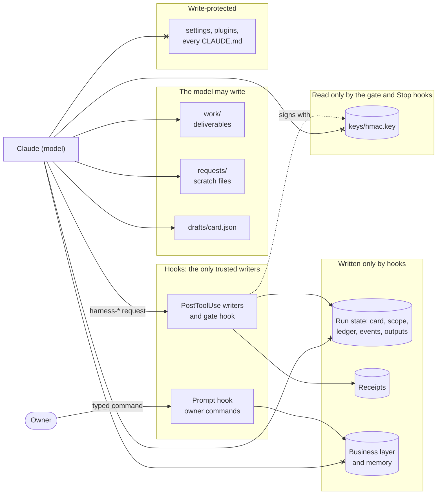

# Security and trust model

dynamic-harness assumes the model can make mistakes, and can be talked into things by text it reads. So the
decisions that matter run in hooks and in an OS sandbox, not in the model. This page lists what the model can
and cannot write, how the harness detects tampering, and what it guarantees.

## Trust boundary

| Can the model... | Answer |
| --- | --- |
| Write its deliverables in `work/`? | Yes. The gate gets a copy, and an edit after the gate needs a new gate. |
| Write its card draft and request files? | Yes, in `.claude/loops/drafts/` and `.claude/loops/<job>/requests/`. |
| Mark a unit as passed? | Only by citing a clean output that the hook recorded for that unit's registered check. |
| Write the ledger, scope, events or receipts? | No. It prints a request, and a hook writes them. |
| Read the run state or the business layer? | No. They are read-denied. |
| Read the signing key? | No. `keys/` is read-denied to every tool and every sandbox. |
| Change settings, plugins or any `CLAUDE.md`? | No. These paths are write-protected. |
| Run a script it wrote? | Only through `harness-sandbox-exec`: no network, no access to the harness's data. |
| Run the owner's commands (`/dynamic-harness:*`)? | No. They run in the prompt hook; a slash command the model types is not an owner prompt. |
| Send, pay or publish? | No. In v1 every irreversible action class is denied. |

## The mechanisms

- **Hooks are the only trusted writers.** Every `harness-*` CLI the model calls only prints a JSON request.
  A PostToolUse writer validates it and applies it, or refuses with a reason. A refused call is still charged
  to the budget.
- **Hash-chained event log.** Each task has an append-only `events.jsonl`. Every event carries the previous
  event's hash and, for a protected file, that file's hash. An edit outside the harness breaks the chain or a
  file hash, and the task stops as `STOPPED_TAMPER`.
- **Protected paths.** The harness's data folder, keys, settings and every `CLAUDE.md` are write-protected.
  Setup adds matching Claude Code sandbox and permission rules.
- **Sandboxed code.** The gate, pack checks and scripts the model wrote run under `sandbox-exec` (macOS) or
  `bubblewrap` (Linux): no network, writes only in their own folder, and the harness's data unreadable.
- **Signed receipts.** The gate receipt is an HMAC over the event head, the scope hash, the submitted files,
  the report, the gate files, the control, business and core hashes, the mode and the caps. The key lives in
  a folder the model cannot read.
- **Replay in the gate.** In done mode, the gate replays every check a passing unit cites, on the deliverables
  as submitted. An edit after a check, a changed stored output or a changed pack entry fails the gate.
- **Fail closed.** Every hook has `onFailure: "block"` and a watchdog. A crash, a timeout or a malformed
  result is a denial, never a pass.
- **Lease.** One session owns a task at a time, with a heartbeat and epoch fencing, so two sessions cannot
  write the same ledger. A second session gets read-only access.
- **Approved procedures (R-5).** The model may load only skills whose content hash is recorded with an
  approver. SessionStart stops the session as `STOPPED_TAMPER` when a shipped skill has no matching approval.
- **Web research is fenced.** Only the web-researcher subagent may use the web, only in an investigation, and
  only under a grant the owner approved in the research plan. Page text never reaches the main model; it gets
  claim rows whose quotes the hook found on the stored page.
- **Owner commands bypass the model.** Setup, business, memory, status, export, config and off run in the
  prompt hook. Every change shows a plain-language plan and a one-time code, and applies only on
  `confirm <code>` in the same session within 10 minutes.

## The Bash classifier is not the boundary

The PreToolUse hook classifies every Bash command and denies what it cannot read statically: unresolvable
paths, `source`, `make`, variables such as `PATH` or `DYLD_*`, recursive readers that reach protected
folders, and so on. It is tuned to fail closed: no parsed option may turn a deny into an allow.

It is still defence in depth. A model running as the same user can find commands the classifier reads
differently from the real tool. The boundary is the OS sandbox: Claude Code's sandbox (configured by setup,
with the data folder read-denied), `harness-sandbox-exec`, and the gate child.

`tests/corpus/bypass.jsonl` holds 200+ attempts to get around the safety hook (shell wrappers, symlinks, `mv`,
MCP, `osascript`, scripts the model wrote, forged receipts), each with its expected decision.

## Guarantees

The design spec states these as numbered requirements. All of them are built in 0.4.0.

| ID | Guarantee |
| --- | --- |
| R-1 | A quick (T0) answer is never slowed down or altered by the harness, apart from the always-on safety hooks and the tripwire. |
| R-2 | A task is "done" only if the gate wrote a receipt whose hash matches the current ledger, scope and submitted files. |
| R-3 | The frozen work list never shrinks silently. Every unit ends in a named state, and a removal must cite the owner's own words. |
| R-4 | No irreversible action runs without approval. In v1 every irreversible class is denied; research page fetches run only under a grant the owner approved. |
| R-5 | The model loads only approved procedures (skills whose content hash is recorded with an approver). |
| R-6 | Writes to the harness's own records are prevented for tools, and detected for everything else. Detection fails the gate and the Stop hook. |
| R-7, R-8 | Questions are capped: at most 5 blocking questions per task, at most 3 start questions, and no new questions after 50% progress. |
| R-9 | User memory is written only by a hook, from structured answers, using a closed schema. |
| R-10 | Every deliverable carries exactly one of three plain-language states (see [owner-guide.md](owner-guide.md#the-three-states)). |
| R-11 | A figure someone will rely on is never a quick answer, and every total is computed by a script. |
| R-12 | Every money figure states its metric and definition version, the period in the owner's calendar and in Gregorian, the source and the date its data runs to, the unit and currency, and the exclusions. |
| R-13 | Every claim in a research report traces to a claim row: a page the harness fetched itself, a verbatim quote, a date and a source class. Load-bearing claims need two independent sources. |
| R-14 | Every number in a forecast traces to a model cell. Results are ranges with drivers and a flip point. The report says "Arithmetic checked; assumptions not." |
| R-15 | Every finished or stopped task writes a decision record outside the workspace, with personal data redacted. |

## Known security gaps

- On macOS, a gate or sandbox child that calls `setsid()` leaves the process group and escapes the group
  kill. Linux is not affected (pid namespace).
- On Linux, bubblewrap cannot refuse creating a new `CLAUDE*.md` or `.mcp.json`. The harness detects it after
  the run and moves the file aside.
- Claude Code's own sandbox on Linux has not been verified live; the harness's own sandbox has.
- Not yet verified on a real Ubuntu 24.04 host with AppArmor's unprivileged-namespace restriction on, on other
  distributions, or on WSL2.
- Every release needs a fresh held-out red-team round. Earlier rounds are now regression tests, so they no
  longer measure unseen attacks.

The full list, with reasons, is in the "Build decisions" sections of
[`dynamic_harness_design_spec.md`](../dynamic_harness_design_spec.md).
